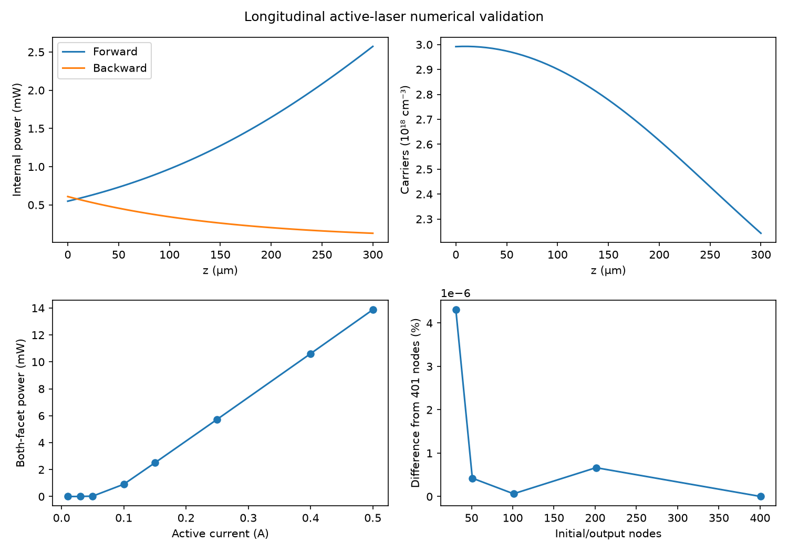
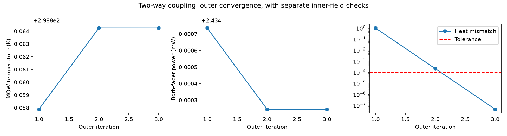
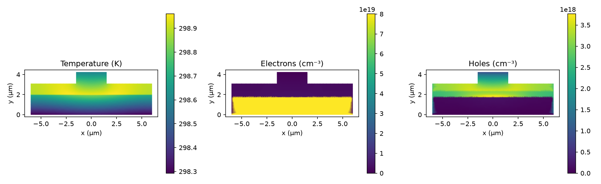

# Longitudinal and two-way solver validation — 2026-10-22

## Open the results

In **Simulator core**, choose **3. Longitudinal 1D solver** or
**4. 1D-2D two-way coupled solver**, then **Visualization & results →
Included validation example**. The examples are shipped with the repository and
work without local jobs or an installed Elmer runtime. They are independent of
the current Device model inputs. Their saved configuration, check table, curves,
field contours, and downloadable JSON/CSV/VTU files are available in that view.

New local runs automatically save `validation.json` beside their results.
Numerical checks are distinct from measured-device qualification. A failed
check remains visible even when a process or the outer loop finishes normally.

## 3. Longitudinal 1D solver

**Outcome: numerical acceptance checks passed for the documented cases.**

Baseline: cavity length 300 µm, effective active width 2.8 µm, thickness 0.342 µm,
R1 = 0.9, R2 = 0.05, active current 0.15 A, temperature 298 K, frequency
1.934e14 Hz; the remaining physical constants are saved in the example inputs.

| Check or result | Observed value | Acceptance criterion |
|---|---:|---:|
| Both-facet optical output | 2.505684 mW | Reported result |
| Front / rear output | 2.444787 / 0.060897 mW | Sum matches reported total |
| Local carrier balance relative defect | 6.83e-15 | ≤ 1e-4 |
| Rear / front mirror relative defects | 1.20e-16 / 2.01e-17 | ≤ 1e-4 |
| Adaptive optical transport residual | 5.78e-7 | ≤ 1e-4 |
| Integrated photon-transport defect | 1.64e-5 | ≤ 1e-3 |
| HR/AR reference power difference | 0.021081% | ≤ 0.5% |
| Symmetric-cavity reference power difference | 0.000192% | ≤ 0.5% |
| Initial-grid refinement, 31–401 nodes | Maximum power difference < 0.000005% | ≤ 0.1% |

The reference is the actual local Lasers `Tools/quasi_3d_synthesizer.py`, evaluated
with matching geometry, current, temperature and 401 nodes. Its SHA-256 is
`ba0962f8092534e565d0cde6c2912f8c7e467d7c1317102fc8be937f14f3cc56`.
Reference and grid-study solves use TLaser tolerance 1e-6. The saved baseline uses
1e-4. This study varies the initial/output grid of an adaptive solver; it is not
a transverse finite-element mesh-convergence study.

Additional checks cover symmetric mirror/profile symmetry, finite positive
carriers and powers, consistency of the gain law, and a monotonic current–power
sweep from 0.01 to 0.5 A. All eight sweep solves converged. Comparisons establish
consistency with the Lasers reduced equations, not measured laser accuracy.



Machine-readable results: [checks](../validation/solver_baseline/longitudinal/validation.json),
[reference comparison](../validation/solver_baseline/longitudinal/reference_comparison.csv),
[grid study](../validation/solver_baseline/longitudinal/grid_refinement.csv),
[current sweep](../validation/solver_baseline/longitudinal/current_sweep.csv).

## 4. 1D–2D two-way coupled solver

**Outcome: outer and inner convergence checks passed; full numerical acceptance
is incomplete because Elmer reports a nonfinite Poynting-vector diagnostic.**

The run uses the reference transverse mesh (1663 nodes, 3218 triangles), a 298 K
heat sink, p-contact potential 0.57724 V, no prescribed external EM drive, 101
longitudinal output nodes, up to 15 transverse iterations, transverse tolerance
1e-4, up to four outer iterations, outer tolerance 1e-4, and relaxation 1. The
device geometry/current/mirrors otherwise match the longitudinal baseline.

| Check or result | Observed value | Acceptance criterion |
|---|---:|---:|
| Outer iterations | 3 | Both residuals ≤ 1e-4 |
| Final heat mismatch | 4.43e-8 | Passed |
| Final relative MQW temperature change | 4.48e-9 | Passed |
| Final MQW temperature | 298.864242 K | Reported result |
| Final both-facet optical power | 2.434245 mW | Reported result |
| Actual mesh MQW area | 9.6e-9 cm² | Matches longitudinal input |
| Final transverse carrier change | 9.81e-6 | ≤ 1e-4 |
| Final transverse thermal change | 2.17e-5 | ≤ 1e-4 |
| Final transverse vector-Helmholtz change | 7.62e-5 | ≤ 1e-4 |
| Transverse stored fields | Finite | Passed |
| Poynting-vector diagnostic | NaN | **Failed** |

The final transverse solve stopped after 11 steady-state iterations. Its raw log
contains `Integral of Divergence of Poynting Vector: NaN NaN`. This is retained in
the validation report and log; no electromagnetic energy-conservation claim is
made. The finite EM field arrays remain available for inspection. The next
qualification step is to resolve this diagnostic and independently verify the
EM energy balance. Outer feedback convergence does not override this failure.

The previous three-transverse-iteration smoke test was insufficient evidence for
inner convergence. This longer run supersedes that smoke result for numerical
assessment; its MQW temperature and power differ accordingly.





Machine-readable results: [checks](../validation/solver_baseline/coupled/validation.json),
[iteration history](../validation/solver_baseline/coupled/coupling_history.csv),
[final solver log](../validation/solver_baseline/coupled/iteration_003/solver.log).
The package retains the final two real VTU snapshots per outer iteration. The
complete local run is `975cf3e5f8da41e4af17d874dc03e701`; it is not required to view
the bundled examples.

## Reproduce

Run the saved coupled configuration using **Configure & run** with a compatible
Lasers runtime, then use its completed job ID:

```powershell
python validate_solvers.py --lasers-root C:/path/to/Lasers --coupled-job JOB_ID
python -m unittest tests.test_cae_validation tests.test_lasers_longitudinal tests.test_cae_workspace
```

The packaging script reruns the longitudinal studies, reads the actual completed
coupled fields/logs, and regenerates the example package. It never fabricates
transverse fields. The manifest records the reference and TLaser longitudinal
source hashes. To preserve this baseline when trying another case, pass
`--output validation/another_case`.

Physical limits remain: configured active current and confinement, averaged
optothermal feedback, reduced longitudinal gain laws, and a reference transverse
mesh. This does not establish a full 3D device solution, experimental agreement,
or general validity over all permitted inputs.
